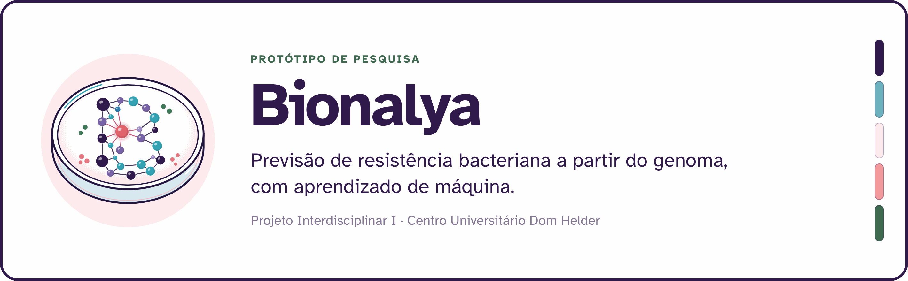
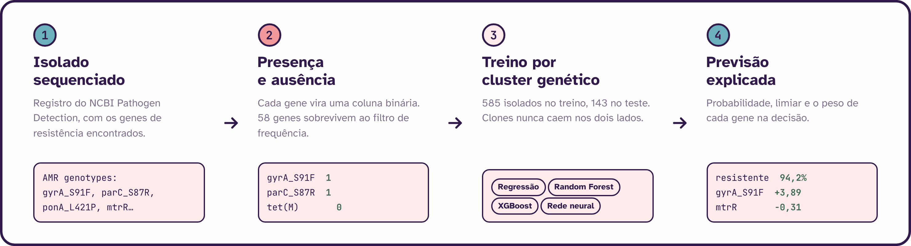
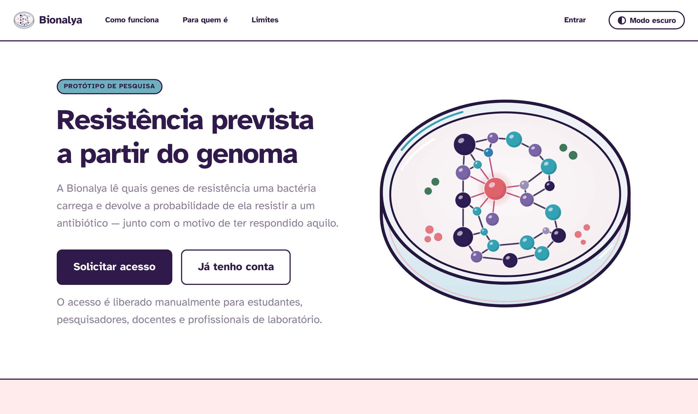
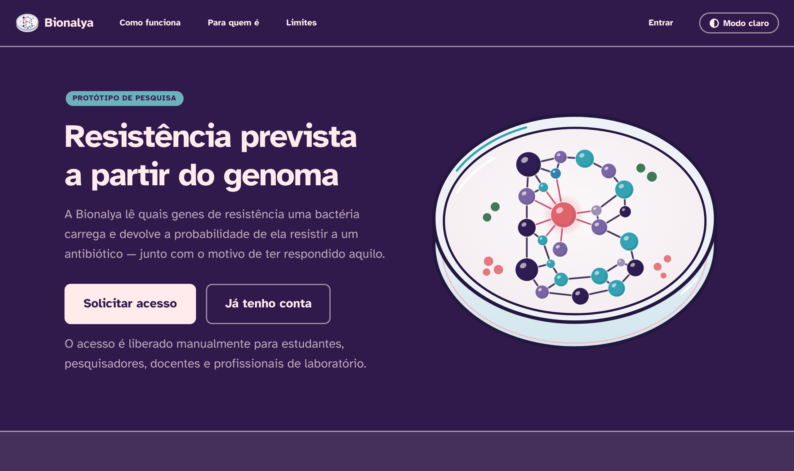
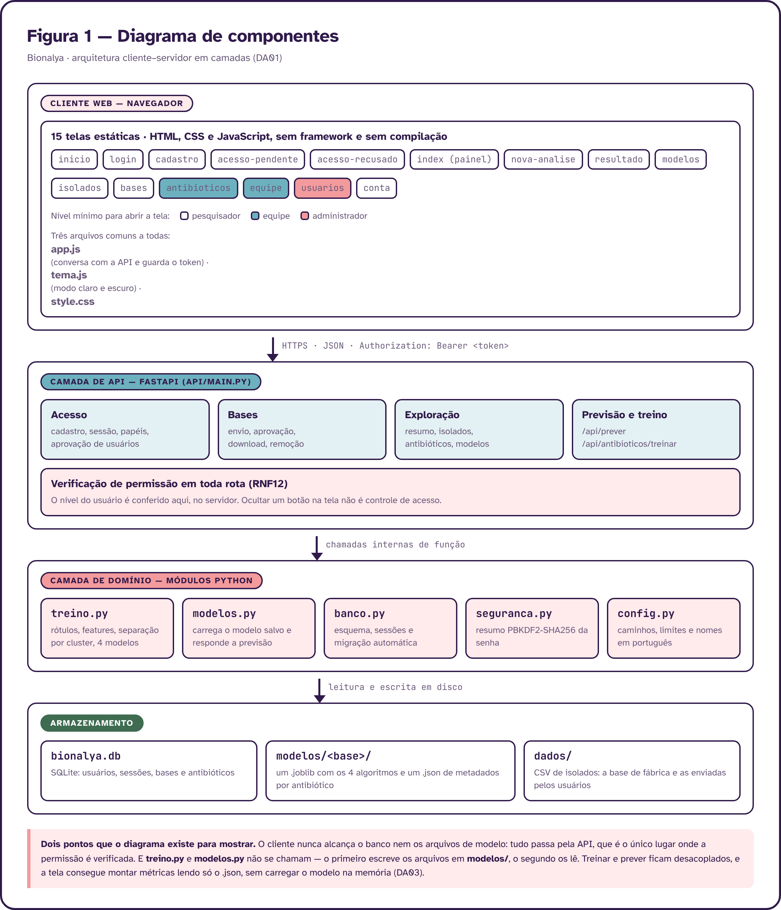

<p align="center">
  
</p>

<p align="center">
  
  
  
  
  
</p>

---

Quando uma bactéria resiste ao antibiótico escolhido, o tratamento certo só começa
depois que o laboratório devolve o antibiograma — e isso costuma levar de 24 a 72 horas.
A **Bionalya** testa uma pergunta mais curta: dá para prever esse resultado olhando só
para os **genes de resistência** que apareceram no sequenciamento da bactéria?

Este repositório tem as duas metades do projeto: o **pipeline de dados e os modelos**
(notebook) e a **plataforma**, que hoje é um sistema funcional — API em FastAPI, seis
antibióticos com quatro modelos treinados cada, controle de acesso com três papéis e
importação de novas bases.

> [!WARNING]
> **Protótipo acadêmico, sem validação clínica.** Nada aqui é diagnóstico e nada
> substitui o antibiograma. Os modelos foram treinados com uma única espécie e podem
> errar — inclusive prevendo "sensível" para uma bactéria resistente.

---

## Como funciona

<p align="center">
  
</p>

O passo que mais mudou o projeto foi o **3**. Numa primeira versão a separação entre
treino e teste era aleatória, e o modelo chegava a AUC 1,000 — bom demais para ser
verdade. O motivo: bactérias são clonais, então cópias quase idênticas do mesmo isolado
caíam dos dois lados e o modelo só precisava reconhecê-las. Trocando para separação por
**cluster genético** (`GroupShuffleSplit`, com `StratifiedGroupKFold` quando a divisão
degenera), o número caiu para o patamar honesto que está na tabela abaixo.

Um detalhe do passo **2** segue a mesma lógica: a frequência dos genes é contada
**só no conjunto de treino**. Olhar a frequência na base inteira para decidir quais
genes viram variáveis já é vazamento de informação do teste para o treino.

## Resultados

Espécie *Neisseria gonorrhoeae*, antibiótico ciprofloxacino, 728 isolados usáveis
(585 no treino, 143 no teste) e 58 genes como variáveis.

| Modelo | AUC | Sensibilidade | Especificidade | Falsos negativos |
|---|---|---|---|---|
| **Random Forest** | **0,994** | 98,9% | 96,4% | 1 de 88 |
| Regressão Logística | 0,990 | 98,9% | 96,4% | 1 de 88 |
| Redes Neurais | 0,985 | 98,9% | 89,1% | 1 de 88 |
| XGBoost | 0,981 | 98,9% | 96,4% | 1 de 88 |

A meta definida no início do projeto, a partir da literatura, era AUC de 0,85.
A validação cruzada em cinco repetições, sempre respeitando os clusters, ficou em
0,990 ± 0,006 — ou seja, o resultado não veio de uma divisão de sorte.

> Os três primeiros colocados ficam dentro de meio ponto percentual um do outro. A rede
> neural é a mais sensível à semente aleatória e oscila mais entre execuções; por isso a
> plataforma guarda os quatro modelos treinados e deixa escolher qual responde, em vez de
> apagar os perdedores.

O gene que mais pesa é o `gyrA_S91F` (36% da importância no Random Forest), seguido de
`gyrA_D95A` (15%) e `parC_S87R` (10%). Isso bate com a biologia: **gyrA** e **parC**
codificam as enzimas que o ciprofloxacino ataca, e mutações nelas são o mecanismo
conhecido de resistência a quinolonas. O modelo não inventou um atalho — ele encontrou
o mecanismo.

### Os seis antibióticos com modelo

| Antibiótico | Modelo escolhido | AUC | Isolados usáveis | Confiança |
|---|---|---|---|---|
| Ciprofloxacino | Random Forest | 0,994 | 728 | alta |
| Tetraciclina | Random Forest | 0,997 | 466 | média |
| Azitromicina | XGBoost | 0,945 | 692 | alta |
| Penicilina | Regressão Logística | 0,972 | 285 | baixa |
| Ceftriaxona | Regressão Logística | 1,000 | 788 | baixa |
| Cefixima | Random Forest | 0,642 | 750 | baixa |

A coluna de confiança não é enfeite. A ceftriaxona tem AUC 1,000 e mesmo assim é
**baixa confiança**: a base tem 775 isolados sensíveis e só 13 resistentes, então o
conjunto de teste fica com umas três resistentes e a métrica deixa de significar
desempenho. A plataforma detecta isso sozinha — menos de 10 isolados da classe
minoritária no teste dispara o alerta — e mostra o aviso na tela junto do resultado.

## A plataforma

| Modo claro | Modo escuro |
|---|---|
|  |  |

São **15 telas** servidas por uma API em FastAPI. O que dá para fazer nelas:

- **Analisar um isolado** — marcar os genes de resistência e receber a probabilidade,
  o limiar aplicado e o peso de cada gene na decisão.
- **Escolher o modelo** — os quatro algoritmos ficam treinados e guardados para cada
  antibiótico. A equipe define qual responde por padrão e quem analisa pode trocar na hora.
- **Explorar a base** — buscar entre os isolados por antibiótico, fenótipo ou gene.
- **Treinar um antibiótico novo** — direto pela tela, a partir da base escolhida.
- **Trazer a própria base** — qualquer pesquisador envia um CSV do NCBI; a base fica só
  para ele até a equipe aprovar o pedido. Cada base treina os seus próprios modelos.
- **Controle de acesso** — cadastro com aprovação manual e três papéis cumulativos
  (pesquisador, equipe, administrador).

A identidade usa cinco cores fixas (roxo `#301A4B`, azul `#6DB1BF`, rosa-claro
`#FFEAEC`, rosa `#F39A9D` e verde `#3F6C51`) e a fonte **Atkinson Hyperlegible**,
desenhada pelo Braille Institute para baixa visão. Todo texto passa no mínimo de
4,5:1 da WCAG AA nos dois modos.

### Arquitetura

<p align="center">
  
</p>

O cliente nunca alcança o banco nem os arquivos de modelo: tudo passa pela API, que é o
único lugar onde a permissão é verificada. E o módulo que treina não conversa com o que
prevê — o primeiro escreve os arquivos em `modelos/`, o segundo os lê.

Os detalhes de cada decisão, a lista de rotas e o passo a passo da hospedagem estão em
[`plataforma/README.md`](plataforma/README.md).

## Estrutura

```
dados_algoritmos.ipynb   Pipeline completo: importação, limpeza, features, treino e avaliação
dados/
  amostra-neisseria-gonorrhoeae.csv   os 794 isolados com antibiograma (versionada)
  neisseria-gonorrheae.csv            base completa do NCBI, 32 MB (não versionada)
plataforma/              A aplicação
  api/                     FastAPI, pipeline de treino, banco e previsão
  web/                     as 15 telas, o CSS e o cliente da API
  modelos/<base>/          um .joblib e um .json por antibiótico de cada base
  Dockerfile               empacotamento para a hospedagem
  README.md                instalação, rotas da API e publicação
bionalya/                Primeira versão das telas, mantida como registro
render.yaml              Configuração da hospedagem
imagens/                 Imagens deste README e diagramas do documento de processo
```

## Como rodar

### A plataforma

Não precisa baixar nada: o repositório já traz a amostra da base e os modelos treinados.

```bash
python -m venv .venv
.venv\Scripts\activate          # Windows
# source .venv/bin/activate     # Linux / macOS
pip install -r plataforma/requirements.txt

cd plataforma
python -m uvicorn api.main:app --reload
```

Abra <http://127.0.0.1:8000>. A documentação da API, gerada sozinha, fica em
<http://127.0.0.1:8000/docs>.

Na primeira vez que sobe, a API cria a conta de administrador com senha aleatória e
grava as credenciais em `plataforma/PRIMEIRO-ACESSO.txt`, que não é versionado.

> **Por que `python -m` e não só `uvicorn`:** no Windows o `uvicorn.exe` costuma ser
> instalado numa pasta que não está no PATH. O `python -m` chama o pacote direto.

### O notebook

Para refazer a análise do zero, baixe a base completa em
[NCBI Pathogen Detection](https://www.ncbi.nlm.nih.gov/pathogens/) — escolha
*Neisseria gonorrhoeae*, baixe o CSV de isolados e salve como
`dados/neisseria-gonorrheae.csv`. Depois abra `dados_algoritmos.ipynb` e execute os
blocos em ordem; eles param com uma mensagem clara se a coluna esperada não existir.

### Hospedar

O repositório traz `Dockerfile` e `render.yaml` prontos. Em
[dashboard.render.com](https://dashboard.render.com), **New → Blueprint**, apontando
para este repositório, monta o serviço sozinho no plano gratuito. O passo a passo
completo e as variáveis de ambiente estão em
[`plataforma/README.md`](plataforma/README.md).

## Limites conhecidos

- **Uma espécie.** Os modelos de fábrica são todos de *N. gonorrhoeae*. A importação de
  base permite trazer outras, mas isso ainda não foi testado com espécie diferente.
- **Antibiograma ausente é o gargalo.** Dos 72.503 isolados da base, só 794 têm
  resultado de laboratório registrado. O limite do projeto é esse, não o modelo.
- **Antibiótico fácil e antibiótico difícil.** O ciprofloxacino depende de poucas
  mutações bem conhecidas. Mecanismos multifatoriais são bem mais difíceis — a cefixima,
  com AUC 0,642, mostra exatamente isso.
- **O banco não sobrevive ao reinício na hospedagem gratuita.** O disco é descartável;
  para uso contínuo seria preciso trocar o SQLite por PostgreSQL.
- **Sem log de previsões.** Deixado de fora de propósito: gravar consulta associada a
  usuário é tratamento de dado pessoal e pede base legal e prazo de retenção definidos.
- **Licença ainda não definida.** Enquanto isso, trate como trabalho acadêmico.

## Equipe

Projeto Interdisciplinar I — Ciência da Computação, Centro Universitário Dom Helder.

| Integrante | Frente |
|---|---|
| Yasmin Lourdes e Silva | Dados, modelos de machine learning e identidade visual |
| Christian Ottero Marques | Scrum Master (gestão do processo) e testes |
| Maria Eduarda Souza Maia | Interface e front-end |
| André Vieira Prado | Desenvolvedor back-end e banco de dados |
| Gabriel Medeiros de Souza | Product Owner (requisitos e backlog) |

## Referências

- NCBI Pathogen Detection — <https://www.ncbi.nlm.nih.gov/pathogens/>
- GBD 2021 Antimicrobial Resistance Collaborators. *Global burden of bacterial
  antimicrobial resistance 1990–2021.* The Lancet, 2024. (4,7 milhões de mortes
  associadas à resistência em 2021)
- Revisão de aprendizado de máquina aplicado à previsão de resistência antimicrobiana.
  *PeerJ*, 2024. <https://doi.org/10.7717/peerj.18213>
  (desempenho relatado na literatura: Random Forest 0,89, XGBoost 0,87, Regressão Logística 0,87)
